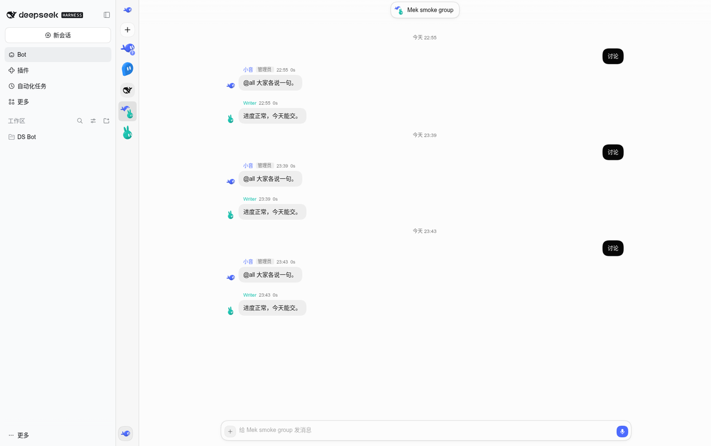

# dsh-mek-bot

[中文](README.zh.md) · [Upstream DS-Bot](https://github.com/Fei2411/DS-Bot)

MakeEpoch's DS-Bot integration for DeepSeek Harness. One **Bot** sidebar entry opens native React components from DS-Bot in the current DSH page. The Bot interface does not boot another DSH application or use an iframe.



## Use

The Bot sidebar keeps upstream's **New**, existing Bots, groups and optional **DSH Agent** row, with collapse and expand controls. Deleting the current Bot or group returns to an available conversation and closes obsolete overlays. Click the conversation title to open its details. The bottom menu contains Usage, Connectors and Bot settings. Logout, scheduled-task controls and the Agent-mode switch are omitted from this Bot surface; DSH's own interface remains available.

Bots have persistent identities, roles, models and memory, and can delegate work or discuss it in groups. The Agent row opens ordinary conversations using DSH's existing workspace navigation. Models, keys and permissions come from your DSH configuration. New Bots do not automatically send a greeting: pick a model and send a message yourself.

## Install

Verified with DSH **0.2.2-alpha.2**, Node.js 24 and current Chromium. The browser must support CSS `@scope`.

```sh
cd ds-bot
npm ci
npm run build
npm pack --ignore-scripts
dsh plugin --profile web add -w ./dsh-mek-bot-0.1.2.tgz
```

Enable the bundle and restart DSH. Do not enable the original `ds-bot` bundle alongside it. Use a package archive for production, never a source link. Keep `autoInstallPeers: false` in the profile; the DSH loader supplies the optional host API peers. Do not install duplicate Cordis, scope, tools or LLM cores.

## Data and boundaries

Team state is saved under `DSH_HOME/mek-bot`, separately from upstream's `DSH_HOME/bot`. Session history stays in DSH. Uninstalling leaves both in place. The bundle does not change global search, presets or native chat settings, and team tools are active only for team-owned sessions.

The native adapter scopes Bot CSS, portals, DOM reads and popup coordinates to its own pane. It does not replace browser globals or patch DSH. Bot dialogs reuse upstream components; group history pages the durable Session log rather than the bounded model-context log.

## Develop and update upstream

The original source layout, Apache license and public Git ancestry are retained. The baseline is pinned in [.makeepoch/upstream.json](.makeepoch/upstream.json). Development dependencies are installed independently in `ds-bot/dev/harness`.

```sh
cd ds-bot
npm ci
npm run harness
npm run build
npm test
node scripts/build-client.mjs --check
npm run lint
```

See [integration boundaries and merge procedure](docs/makeepoch-integration.md). The retained desktop/Docker code is upstream reference material, not this plugin's release entry. Original documentation remains in [README.upstream.md](README.upstream.md).

## License

[Apache-2.0](LICENSE), with [upstream and third-party notices](NOTICE) preserved. This is an independent community integration, not an official DeepSeek product.
