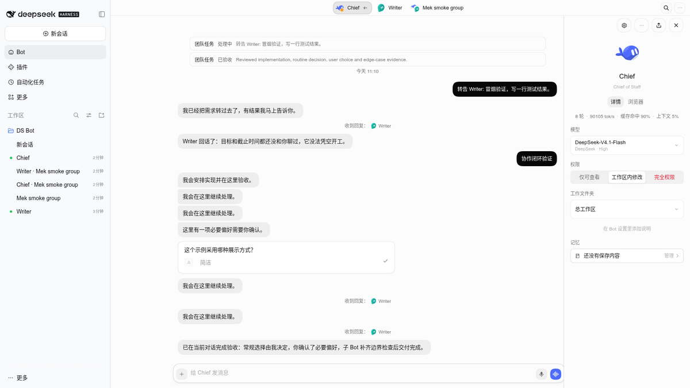

# dsh-mek-bot

MakeEpoch 基于 [DS-Bot](https://github.com/Fei2411/DS-Bot) 开发的 **DSH 多 Bot 协作插件**。在现有 DeepSeek Harness 工作区中组织长期助手：由一个 Bot 接收需求，调用其他 Bot 分工处理，收集问题和结果，再审查、返工并向用户交付。

本项目只发布 DSH 插件，复用 DSH 的模型、Session、工具、权限和自动化。当前插件版本为 **0.2.12**，已合并上游 **v0.2.7**（含此前版本）；逐版本的吸收情况见[上游合并记录](docs/fork-vs-upstream.md)。

0.2.12 修复停滞提醒误报：等待、阻塞与执行各用各的阈值，任务卡列出关不了的原因并支持手动收口浏览器交接；0.2.11 起优先复用上游群聊、记忆、模型与输入能力，并在现有任务体系中吸收阶段概览思想；WechatPad 关联通过可选服务接入。源码及隔离验证不代表正式 DSH 已安装生效。



截图于 2026-10-31，来自 DSH 0.2.2-alpha.2 中安装的 dsh-mek-bot 0.2.4；使用隔离环境和本地模拟模型，展示顶部导航、负责人任务摘要与 Bot 详情。

## 项目提供什么

- **精简顶部导航**：默认保留主 Bot 和收藏会话；右侧 Bot 列表浏览其他 Bot 与群聊，五角星收藏后固定显示在顶部。未收藏的当前会话临时显示，切走后收起；收起会话的新消息和任务在列表入口提示。顶部保持单行圆角标签，不显示详情箭头或置顶图标；未读红点贴在头像右上角，点击当前标签仍可展开详情。任务卡片长标题自动换行。
- **长期 Bot 团队**：为每个 Bot 配置名字、职责、指令、模型、工作目录和记忆；上下文轮换时身份保持不变，历史仍可查询。
- **单聊与群聊**：可以直接找某个 Bot，也可以由 Bot 委派任务、组织群聊讨论。长文本随聊天列换行，宽表格和代码块在各自区域横向滚动，群聊连续回复为头像缩进和工具栏保留空间。对话和执行沿用 DSH Session，不另外实现一套 Agent 运行时。 持续排队的消息显示在输入框旁，点击数量可介入当前轮次或移除。
- **负责人交付闭环**：用户最初联系的 Bot 持有任务，执行 Bot 的问题和结果回到这里；结果经过检查与验收后再交付；任务面板区分执行中、待处理与已结束。
- **团队运营**：集中查看任务和重要动态，配置执行策略、共享摘要、项目事实与可复用流程。
- **融入现有 DSH**：保留宿主导航及其他插件，Bot 界面在自己的面板内渲染；模型、密钥和授权继续使用已有配置。

长期身份、记忆、群聊、Bot 间通信、浏览器和基础文档能力来自上游。本项目重点增加插件共存方式、固定任务归属、决策回流、结构化验收和团队运营；不把上游原有功能都归为 fork 新增。

## 与上游有什么不同

对照范围为当前合并的上游 **v0.2.7**（含此前版本）。上游本身也支持插件与委派，下面列的是本项目的接入选择和扩展。

### 前端交互

| 方面 | 上游 DS-Bot | 本项目 |
|---|---|---|
| 产品形态 | 提供独立桌面、移动端及 DSH 插件 | 只交付 DSH 插件；保留的 `app/`、`mobile/` 是共享源码及上游参考 |
| 导航布局 | Bot 模式的全局界面与 Bot 侧栏 | DSH 左侧只加一个 Bot 入口，Bot、群聊和可选 Agent 放在顶部导航 |
| 详情面板 | 配合上游 Bot 侧栏布局 | 再次点击当前对话切换 Bot 详情；宽屏并排，窄屏在 Bot 面板内覆盖聊天 |
| 宿主共存 | 上游客户端入口管理全局 Bot 界面 | 原生 React 组件接入公开 slots，CSS、弹窗和坐标限定在 Bot 面板内；无 iframe、无第二套 DSH |
| Agent 与设置 | 提供 Bot/Agent 模式切换及账户、计划任务入口 | Agent 从顶部列表打开 DSH 普通会话；不增加外层 Agent 菜单，Bot 内隐藏登出、模式切换及计划任务控件，自动化由 DSH 管理 |
| 任务可见性 | 已有运行及委派进度 | 负责人对话内增加任务摘要、待决问题、结果、取消及真实授权/凭据卡；团队概况集中查看历史和产物 |
| 运行状态与交互请求 | 已有工作状态、提问及 `show_view` | 当前单聊和群聊末尾显示思考/工具执行状态，结束后移除，不写入消息历史；补齐待回答 `show_view`，并按会话消费 DSH 公开的 question/plan-review 请求 |
| 状态恢复 | 使用上游的会话与界面状态 | 每个标签页恢复 Bot 面板和所选 Bot/群聊；按 Bot 身份找到最新会话段，显式 DSH 会话链接优先；删除对象后清理失效面板并切换到可用对话 |

状态行复用已有执行状态逻辑：单聊只显示当前正在工作的 Bot，纯文本流式回复时沿用原有让位规则；群聊按本群正在工作的成员逐一显示头像、当前动作及用时，轮次已让出发言位但还在执行的成员也可见，完成或停止后自动移除，不混入私聊及其他群的动作；查看较早消息时不强制滚回底部。任务列表可整体收起；列表底部的“显示更多任务”居中排列并显示剩余数量。选择卡、授权及凭据请求保持可用。DSH 原生选择请求复用宿主的回答/关闭回调，不转成普通聊天消息；尚未公开给当前会话的其他宿主面板请求不在此适配范围。

Bot 详情中的“当前会话权限”读取 DSH 实际权限；点击“在 DSH 中设置”打开该 Bot 当前会话，在原生输入区的权限菜单中选择模式。DSH 启用实验自动审查插件时，这里包含自动审查及其原生风险确认；返回 Bot 后状态同步。“Bot 跨会话权限”另行折叠显示，修改会应用到当前单聊、继承该权限的群聊和后续新会话，仍不把 `auto` 保存为 Bot 默认值。当前版本不支持直接在 Bot 面板内嵌 DSH 权限下拉框，因此采用明确的原生会话跳转；浏览详情不会自动切换宿主主会话。

**当前 Bot 面板未接入 DSH 原生会话右侧栏。** 上表的“详情面板”是 Bot 自己的详情。通过宿主主会话挂载文件/终端侧栏的方案暂不实施。

### 底层协作逻辑

| 方面 | 上游已有行为 | 本项目的扩展或约束 |
|---|---|---|
| Bot 间委派 | `message_bot` 可触发其他 Bot，默认结果回发起方，也支持 `reply_to: user` 让执行 Bot 在自己的窗口直答用户 | 在本项目入口强制委派结果回发起方，拒绝 `reply_to: user`；原始用户联系者保持任务负责人 |
| 执行中遇到问题 | 已有提问、消息、handoff 和回传机制 | 委派中的 `ask_user` 转给负责人并挂起原工作；负责人处理常规选择，必要时在自己的对话问用户，再恢复同一子任务 |
| 子任务完成 | 上游执行并汇总委派结果 | 执行 Bot 用 `report_bot_task` 返回状态、结果、验证证据和产物，完成报告进入待审状态，不能自行把整项任务验收为成功 |
| 返工和最终验收 | 沿用上游任务传递底座 | `revise_bot_task` 在同一根任务下创建新尝试；只有负责人能 `finish_bot_task`，未结工作、问题、失败、未知送达和缺失证据会阻止验收 |
| 群聊协作 | 群聊讨论、用户 @成员及结果回传 | Bot 在普通回复里提到成员时只显示提及。群管理员在群内首次调用 `message_bot` 即持久化主任务；多级派工逐层回传至原群管理员验收。`post_to_group` 只有显式传入 `report_back: true` 才会派工；普通公告只写入群历史；讨论轮次结束不等于整个任务完成 |
| 重启与重复投递 | 上游已有持久 handoff、结果保留及命名请求去重 | 额外持久化根任务、问题和待发消息，恢复时核对收件箱和持久历史；不能确认送达时保留“不确定”，不盲目重复 |
| 团队知情 | 已有团队、群组和记忆 | 增加可控的任务摘要共享与重要事件通知；主助理知情不会改变直接联系 Bot 的任务归属，也不会自动读取私聊原文 |
| 执行与数据边界 | 使用 DSH 模型和工具服务 | 团队工具限制在团队会话；新增策略、资源协调、项目事实和流程校验；团队状态默认独立存于 `DSH_HOME/mek-bot` |

文件查询优先使用 DSH 的 `read`、`grep`、`glob`，它们可以与同目录的写入并行。已知写入工具和通用 Shell 继续协调工作目录占用。同目录有活跃占用时，对话显示持有者、目录和等待时间。等待达到 30 秒后，本次调用返回未执行，原操作继续运行。

在 DSH 插件页启用「Codex 子智能体」后，Main Bot 私聊可以调用 DSH 的 `subagent_codex`。对话显示运行状态并提供「停止 Codex」，完成或停止结果由 DSH 送回原对话。执行沿用 DSH Codex 提供方的权限和工作目录配置。团队派工继续使用 `message_bot`。

这里的“主代理/子代理”主要指**负责人与执行 Bot**。它们是长期 Bot 之间的任务关系，不等同于 DSH 单个 Session 内的临时 subagent。上游 Main Bot 是拥有团队管理权限的角色；本项目任务负责人则是用户最初联系的 Bot，不要求它一定是 Main Bot。

## 主 Bot 如何调用其他 Bot 并收回结果

例如，你对主 Bot 说：“请让编程 Bot 修复问题，再请测试 Bot 验证。”

1. 主 Bot 通过 `message_bot` 向编程 Bot 发送目标、上下文、约束和验收标准。执行 Bot 收到任务后运行；其结果会作为新消息唤醒发起方，无需持续轮询等待。
2. 编程 Bot 遇到需要决定的问题，使用 `ask_user` 挂起当前子任务。问题先回负责人；负责人可自行判断的用 `answer_bot_question` 回答，必须由用户决定的仍在主 Bot 对话中询问。
3. 编程 Bot 用 `report_bot_task` 回报完成、阻塞或失败，并附验证证据与产物。主 Bot 通过 `list_tasks`、`read_task` 检查结果，可继续委派测试 Bot 验证。
4. 有遗漏时，主 Bot 用 `revise_bot_task` 要求修正，保留同一根任务及前后尝试的关联。群聊委派同样回到原负责人，不要求用户换窗口追踪。
5. 子任务和问题全部解决、验收条件有证据后，负责人用 `finish_bot_task` 接受任务，在原对话交付结果与剩余限制；也可用 `cancel_bot_task` 取消尚未完成的任务。

群内正式派工使用 `message_bot`：管理员首次派工自动保留用户目标和原群入口，成员可在同一任务内继续委派；修复结果先交检查者，再交管理员收尾。成员不能从普通讨论另起正式任务；普通 `@`、公告和闲聊仍不自动建立任务。执行中的 `@` 文本不代替派工工具，交回上游用报告，二次检查用原任务返工；阻塞不能当成完成。已有普通讨论不会在升级时自动重放。

群管理员每轮都会收到协调提示：先按成员职责分工、实际派发后再告知用户，成员执行期间不重复接手，返回后检查证据。普通闲聊和简短回答无需派工；用户只要方案、等待确认或仅记录的边界继续保留。群公告仍可补充本群的角色安排，私聊和普通成员不会收到管理员专用提示。

任务标题描述实际交付目标，与用户原话、群成员提示、进度和最终结果分开保存；“记得分工”“可以接受”不应成为新任务标题。正式派工使用 `task_title` 命名，继续已有任务使用明确的 `task_id`；同一任务下对同一目标重复发送相同指令会返回已有派工编号。继续派工保留原任务标题；负责人可用 `name_bot_task` 更正旧标题，不重派任务、不改变验收状态。待办继续用 `plan_todo` 的标题和稳定 ID。

设计等步骤检查通过后，正式派工的原派发人用 `accept_bot_work` 记录该步骤已验收；待办子任务用 `control_todo accept`。后续实现/验证仍在同一主任务内继续，整个目标完成才用 `finish_bot_task`。口头说“已通过”不会伪造验收记录。成员在本群正式派工中的进度和结果同步写入群持久历史，刷新可读；展示这些消息不会再次派活，结构化报告继续保存在任务中。

没有结构化报告的返回结果显示“待补报告”。展开任务点“补报告”，根据已保存的结果填写摘要和已核对的证据；Bot 可用 `supplement_bot_report` 完成同样的记录。补报告保留原派工、结果及产物，不唤醒执行 Bot。报告齐全后显示“待验收”，验收时填写结论和证据，并逐条核对已设标准。真正遇到阻塞或失败时，先解决前置问题，再用“处理阻塞”提交说明并重试该项。旧的未关闭结果按现有记录显示这些状态，并向原委派方发送一次持久化处理提醒；重启保留提醒回执，不反复唤醒，也不改写已验收或已取消的结果。

右键点击正在等待委派结果的 Bot，可选择“放弃等待”并指定一项。父任务会收到该项未返回的通知，同批其他等待继续。正式派工的迟到结果在任务卡单独标记，供负责人核对。

任务卡直接列出“关不了的原因”并点名具体编号：待补报告、待接受的结果、未答问题、未确认投递、阻塞/失败、等待授权或凭据。等待浏览器交接单独显示已等分钟数，任何情况下都不会被显示成执行中。拒绝信息同样点名具体 work、问题或投递编号，`accept_bot_work` 与 `finish_bot_task` 与看板使用同一份未决清单，不会出现“看板说能关、验收仍被拒”。

停滞阈值固定写在 `ds-bot/src/host/mek-coordination.js` 顶部常量中，调整时须同步更新本文与 UI 测试记录：

- 等待浏览器交接、等待决策/授权/凭据超过 **10 分钟**：标记为停滞；
- 阻塞、失败、结果待核对与未确认投递超过 **2 分钟**：记录为停滞（给人工留反应窗口，不零秒触发）；
- 执行中超过 **30 分钟** 没有状态变化：视为长时间无进展（按任务行的更新时间判断，不引入逐轮心跳，属于粗粒度提示）；任务行仍在更新就不算停滞；
- 待补报告、待接受的结果与未答问题按 **10 分钟** 计；
- 任一未决项越过自己的阈值才提醒，提醒只列越线的项；未决状态超过 **60 分钟** 升级为团队动态，并再次提醒负责人。

停滞提醒不向负责人会话投递任何 durable 文本——负责人的私聊就是用户对话框，过程提醒属于噪音。它只走两条通道：任务所属群的 quiet 群消息（以群管理员身份写入群持久记录，不选人、不新建任务）与团队动态/任务面板 attention 红点，主助手只收结论。`close_browser_wait` 只允许任务负责人或群管理员调用，被卡住的执行 Bot 不能自己关闭；它只改任务状态、保留已交付结果，并在报告中写明“页面未确认、未重放任何浏览器动作”，不释放也不接管浏览器。stale 或已过期的资源租约只在提醒中列出提示，本插件绝不自动释放。

自动判定失联的判据刻意保守，只认两种确定性缺失：控制句柄不再匹配、或该 Bot 已被删除。**worker 会话不在 live 表只是“未确认”，不判失联**——空闲会话可能暂时不在那张表里，仅凭它判断会把“慢任务”变成“假空闲”。自动写入只会**追加**系统判定说明（标注 `[System]`），不覆盖已交付的结果或报告；判定后的状态是“待人工收口”，绝不会写成完成、成功或代替负责人验收。之后负责人仍可用 `close_browser_wait` 收口并按验收标准结束任务。

用户直接找编程 Bot 开始的对话仍然独立，不会自动归到主 Bot。真实工具授权及安全凭据请求必须由用户在对应卡片中处理，负责人不能代批，Bot 也看不到凭据值。已有的旧上游 handoff 不会被擅自重新归类，新归属机制从新的委派开始生效。

这些规则同时由提示词和运行时状态、工具权限及验收检查支持。系统可以检查回报和证据是否齐全，但不保证真实模型一定正确执行或判断业务结果。

## 会话待办与定时事项

右侧面板顶部固定“详情 / 待办 / 任务 / 浏览器”标签（群聊没有浏览器），切换标签不重建整块面板，头像属于详情内容。“待办”收纳尚未开始的未来计划，手动开始、指定时间、每天或工作日都在同一个“新增”表单中设置；表单默认收起。开始后，同一事项进入“任务”，展示具体方案、子任务和验收进度；暂停或等待前置仍属于任务。周期计划保留在待办，每期的执行记录进入任务。任务页合并展示已启动事项与兼容的旧团队执行记录，不重复显示关联记录；分为“执行中”“待处理”“已结束”。待补报告、待验收、阻塞和需用户操作的任务归入“待处理”，已结束默认折叠。已无在途派工的团队任务可填写原因后归档，原派工和结果仍可在“已结束”及团队任务记录中查看。

顶部 Bot/群入口及待办、任务标签使用红点提示未读任务变化；消息未读继续来自已有 DSH 会话状态，并在顶部统一显示红点。任务红点独立于消息：只打开 Bot 不会清掉，条目实际进入可见区域才确认已读。新增、重要调整、待验收或阻塞等变化会提醒，轮询和排队到执行中的普通变化不反复提醒；自己通过表单创建或操作的事项不会给自己制造未读。首次升级将现有记录作为已读基线。任务已读标记按内容指纹保存在当前浏览器本地，刷新和同源多标签共享；不同设备或浏览器之间尚不共享。

用户无需创建项目或填写负责人。群管理员通过 `plan_todo` 保留一个主任务，安排稳定子任务、成员和依赖；`control_todo` 开始或检查结果，`list_todos` 查询当前版本。成员继续通过 `report_bot_task` 回报，返工保留子任务身份与派工历史；分配的群子任务会出现在成员的任务页。

依赖要求所有前置结果通过检查后才派工，主任务的前置也约束子任务，支持同会话范围的任务关联，并拒绝循环（包含父子完成关系）。等待不启动模型轮次；前置返工后，已运行或已验收后继的旧输入版本会显示阻塞，需要管理员重新核对，不能据此继续派工或验收主任务。完成仍经过现有结构化报告、证据和整体检查，不把一轮聊天结束当作完成。

定时支持提醒、生成周期待办和自动通知管理员安排执行，默认北京时间；界面支持单次、每天、工作日，工具还支持指定每周日期。时钟复用 DSH 公开 `schedule` 服务，插件读取其持久化投递凭据，按规则和计划时间去重。上期未结束时跳过本期，同批恢复的回执也遵循此规则；超过计划时间一分钟才投递或处理的实例保留为错过，不自动补跑。暂停阻止后续触发；当前 Host-wide 调度服务在原绑定上暂停/恢复，保留 id、历史和执行目标；旧 Session 级服务仍沿用原适配。仅有提醒、没有投递历史接口的宿主显示不可用。

自动执行先建立主任务，再通过持久通知要求管理员拆分和启动，实际模型安排能力仍需真实模型验收。宿主的时钟提醒会进入绑定 Bot 的 Session，插件禁止该内部唤醒直接调用工具，业务执行以凭据创建的事项为准。未知通知不盲目重发。

通过 DSH 的 `schedule_list/view/edit` 管理团队调度：Main Bot 可管理本团队非隐私 Bot 和群的任务，普通 Bot 只管理当前逻辑聊天（含旧会话段），不开放普通 DSH 或其他隐私 Bot 的任务。管理归属与执行目标分开，支持 `this_session`、`new_once`、`new`；独立执行仍使用 DSH 新会话，不冒充 Bot 聊天。新建成功后持久保存 Bot/群身份；可确认的已有团队会话目标或待办规则绑定会纳管，不凭标题、目录或 `involvedSessionIds`（其中包含编辑者）认领独立旧任务，旧独立任务需另行核实真实创建来源。编辑带回最新 `updatedAt` 作为 `expectedUpdatedAt`，陈旧或缺少版本时拒绝覆盖。

定时待办的 `schedule_edit` 会经过规则层同步标题、业务指令和时间，保留内部时钟提示与执行目标，旧实例保留内容快照；不允许把规则绑定改成独立执行。规则写入结果未知时保留意图、停止该规则处理并按绑定修订标记核对，不删除重建或自动重发。无法确定回执对应版本时保留为待核对，不套用当前指令；启停及删除带回页面看到的版本，防止陈旧页面覆盖新修改。归属落盘失败会撤回内存认领，团队只读时禁止继续编辑宿主定时任务。并发改目标前先确认归属已保存；编辑意图保存失败后可安全重试。已保存的时钟绑定不被复制提示的其他时钟替换，绑定丢失或多个绑定进入待核对；异常回执不启动工作，内部时钟限制不被宿主上下文清除。完整自助对账、完成后重开及任意外部条件仍待补齐；2026-11-06 已完成隔离 DSH 0.2.2-rc.1 与卡片浏览器验证，并安装到正式环境；未操作正式定时记录，旧独立任务归属仍需核对。设计及本轮验证边界见 [完整方案](docs/plans/2026-11-03-mek-conversation-tasks.md)。

## 团队协作与复用

在 **Bot 设置 → 团队概况** 中集中查看任务历史、重要动态、执行策略、项目事实和复用流程。

- **主助理知情**：选择主助理，按 Bot 开关摘要共享。默认共享明确登记的任务摘要；普通进展只记录，阻塞、失败或需要用户决定时发送去重通知。关闭通知仍可查询授权摘要；关闭共享后不能继续查询该 Bot 的摘要，已送达历史无法撤回。
- **执行策略**：设置通用、编程或自定义职责及禁用工具，限制任务并发、返工次数、期限和 token 预算。预算在后续模型请求及工具调用前检查，正在生成的回复可能超过限额；服务商缺失用量保持未知，不估算费用。
- **资源协调**：已识别的工作区写入、浏览器和显式绑定的账号工具先取得独占使用权；工具自动租约在执行结束后释放，等待同一资源的调用会继续执行；DSH 后台任务运行期间保留占用。显式申请、旧版本遗留及结果不确定的占用需核实后释放，不能仅凭到期抢占。它不能隔离任意 shell、后台进程或未接入的外部客户端，真正隔离需使用独立工作区和账号。
- **项目事实**：用户创建共享范围，成员主动提交带来源、版本和失效时间的事实；冲突保留待核实，旧版本可查，不自动汇入私聊记忆或凭据。
- **复用流程**：保存输入、指令和验收标准，先完成并接受验证任务，再启用该版本；更新产生新草稿。运行复用任务协调器，定时触发使用 DSH 自动化。
- **产物查看**：从任务查看来源会话中的文本、图片和文件，保留产物来源；预览和下载沿用宿主公开文件接口。
- **浏览器观察与接管**：观察已打开的 Bot 浏览器，显式接管和归还；人工接管时暂停 Bot 输入。观察本身不新建浏览器，需要可用的浏览器能力；密码框在截图中遮盖，输入文本不写入任务记录。
- 启用 `script` 浏览器后端时，`browser_exec` 每次在独立子进程运行，通过浏览器操作接口访问页面，沿用浏览器审批和接管规则。脚本运行超过 20 秒会被终止。

多标签页/多窗口通过共享 feed 与心跳选举减少重复长连接；不支持 BroadcastChannel 的浏览器退回每个可见页面一条流。群聊历史从持久化 Session 日志分页读取，不依赖给模型看的有限上下文。跨段消息按来源 Session 和段内序号区分，图片从原始 Session 读取；切段后重新加载当前段，旧段仍可上翻。

群轮次和正式派工将原图交给支持视觉的成员，文本模型可使用图片解读。群详情的“全部停止”只处理本群回合及实际子代理，单个成员停止失败时继续处理其他成员。模型输出达到上限时，群回复和委派结果标记为未完成。连续两轮因输出上限而没有可用文本时，Bot 会在适合换段的条件下带历史进入新会话段。

## 日常使用

在「Bot 设置 → 群聊 → 新建群聊」里先选群管理员，再添加至少一位其他 Bot。管理员已计入群成员，界面会显示选择人数。群名选填，留空时按成员命名。

单聊和群聊输入框键入 `@` 可搜索候选成员，方向键选择，Enter/Tab 插入，Escape 关闭；输入法确认不会触发选人或发送。普通群聊的点名与正式委派有不同的任务记录：正式任务中继续派活使用 `message_bot`，普通讨论直接在群中回复。

顶部导航选择 Bot、群聊或可选 DSH Agent；再次点击当前对话展开或关闭右侧面板。右上角菜单提供新建、用量、连接器和 Bot 设置。清单图标打开“任务”，相邻“待办”展示未来计划；切换 Bot/群时保持所选待办或任务标签并更新范围。聊天区不放任务列表，授权、凭据及交互卡继续独立显示。团队概况中的完整历史保留原搜索和分页。删除当前 Bot 或群聊会清理过期弹层并回到可用对话，DSH 左侧栏保留原有开合行为。

聊天支持选择、粘贴和拖拽图片，发送前可预览，也可只发图片；发送被拒绝时保留文字和图片。图片输入等共享能力不作为本 fork 独有功能宣传。

模型、密钥和权限来自已有 DSH 配置。新 Bot 默认不会主动调用模型发欢迎消息，选择模型后自行开始聊天。模型调用使用所配置服务商的额度。

## 当前能力边界

上游 v0.2.4 的私有 Bot、Office 文档、技能建议、AGENTS.md 更新建议、群聊全部停止和 Deep View 代码，以及 v0.2.5–v0.2.6 的群聊轮次调整与投递修复均已并入。私有 Bot 的工具/路径限制不构成系统级隔离；Office 在 DSH Web 中依赖额外运行环境，完整文档处理链路尚未验证；与独立 Deep View 插件共存也尚未实测。不要将“源码已合并”理解为所有部署环境都已验收，逐项状态见[版本合并记录](docs/fork-vs-upstream.md)。

自动化与隔离 DSH 验证使用本地脚本模型，只证明相应系统流程，不代表真实模型或实际业务必然正确。UI 的分层测试、用例及验收记录方式见 [UI 测试方案](docs/dev/mek-ui-testing.md)。

## 安装

本轮隔离集成验证使用 DSH **0.2.2-rc.1**、Node.js 24 和 Chromium；单元兼容检查仍使用 `dev/harness` 的 **0.2.2-alpha.2**。浏览器需要支持 CSS `@scope`。

```sh
cd ds-bot
npm ci
npm run build
npm pack --ignore-scripts
dsh plugin --profile web add -w ./dsh-mek-bot-0.2.12.tgz
```

启用 bundle 后重启 DSH，不要同时启用原 `ds-bot` bundle。生产安装必须使用打包文件，禁止 `link:`、符号链接或直连开发源码。profile 保持 `autoInstallPeers: false`；宿主 API 由 DSH 加载器提供，不能安装第二份 Cordis、scope、tools 或 LLM 核心。

浏览器功能随包提供可选 Playwright 依赖；启用前需本机 Chromium/Chrome。Linux 示例（按实际安装路径调整）：

```yaml
- id: mek-bot
  config:
    browserPlugin: refs
    browserHeadless: true
    browserExecutablePath: /usr/bin/google-chrome
```

服务重启会关闭进程内浏览器。登录资料保留在各 Bot 独立目录；等待交接的任务会明确转为阻塞并回报负责人，需确认后重开，不会自动重复网页操作。

## 数据与配置

团队数据默认在 `DSH_HOME/mek-bot`，与上游的 `DSH_HOME/bot` 分开；聊天历史仍由 DSH Session 服务保存，卸载不会删除这些数据。可在当前用户的 `cordis.patch.yml` 中设置：

```yaml
- id: mek-bot
  config:
    mainName: 小音
    mainRole: 主助手
```

插件不改 DSH 源码、全局搜索、预设或原生聊天设置。团队工具只对团队拥有的会话生效。Bot 的 CSS、弹窗、DOM 读取与坐标限定在自己的面板内，不替换浏览器全局对象，不重复加载其他 DSH 插件。群聊记录从持久化 Session 日志分页读取，不依赖给模型看的有限上下文日志。

## 开发与文档维护

保留上游目录、Apache 许可证和公开 Git 历史，基线见 [.makeepoch/upstream.json](.makeepoch/upstream.json)。插件入口是 `ds-bot/mek.js`，原生界面位于 `ds-bot/src/client/mek/`，任务协调和团队运营位于 `ds-bot/src/host/mek-*.js`。保留的上游入口不安装本项目协调扩展。

```sh
cd ds-bot
npm ci
npm run harness
npm run build
npm test
node scripts/build-client.mjs --check
npm run lint
```

项目介绍、当前特性和上下游差异统一维护在本中文版 README；`ds-bot/README.md` 是安装包内的同步副本，`README.zh.md` 仅保留兼容链接。新增功能或改变交互、权限、持久化及恢复行为，必须在同一改动中更新这里及相关集成/设计文档；界面变化同步更新 UI 测试矩阵，合并上游则更新版本记录。

- [上游版本与合并记录](docs/fork-vs-upstream.md)：每个版本上游改了什么、本项目采用什么、保留什么及验证状态。
- [集成边界](docs/makeepoch-integration.md)：宿主职责、适配位置、运行及恢复约束。
- [任务所有权设计](docs/plans/2026-10-30-mek-task-ownership.md)、[团队运营设计](docs/plans/2026-10-30-mek-team-operations.md)：底层机制与契约。
- [UI 测试方案](docs/dev/mek-ui-testing.md)：组件、真实浏览器、隔离 DSH 和安装包的验证层次。
- [上游原始说明](README.upstream.zh.md)：保留上游介绍，不作为本项目功能与验收声明。

## 许可证

继承上游 **Apache-2.0**，保留 [LICENSE](LICENSE) 与 [NOTICE](NOTICE)。本项目是独立社区集成，与 DeepSeek 官方无隶属关系。

## 2026-11-05 上游复用与微信关联

已吸收上游 v0.2.7 的群聊运行修复、记忆变更历史/单次恢复、新 Bot 默认模型、Enter 发送偏好及失败处理；选择性吸收 dev 的 DSH 0.2.2 调度兼容。包号 0.2.12 是下游版本，上游基线仍以 `.makeepoch/upstream.json` 为准。

从上游 v0.3.2 选择性移植了浏览器脚本隔离和插件热重载恢复。插件热重载后，仍由 DSH 执行的 Bot 回合会恢复活动显示和团队工具，进行中的委派继续向原请求方回传结果。

群目标继续采用现有待办、依赖和逐层验收；吸收上游目标对齐、阶段概览和防空转思想。右侧任务展开后显示阶段和已验收数量，目标与验收条件可展开查看，成员回报与已验收证据分别展示；不会因为阶段回报齐全自动验收整个任务。现有导航和标签位置不变。

WechatPad 0.1.10 可将微信私聊关联主 Bot、Pad 微信群关联 Bot 群，入口在主 Bot / Bot 群右侧详情面板的设置中。可选择 WechatPad 或微信机器人连接，再选择已发现的微信用户或微信群；用户发来消息后即可选择，无需查 ID。微信群候选和已关联列表显示群名及群 ID，方便辨认同名群；暂时取不到名称时标为“未获取到群名”。微信设置的“会话”页仅显示关联汇总。普通 Bot 不能关联。绑定沿用目标的当前会话段，群成员可见文字带名字回传微信；不外发隐藏 Bot 回合或推理，不启用上游 IM 模块。仍遵守 WechatPad 访问控制；授权、密钥和交互卡在 DSH 处理。详见 [能力比较与关联设计](docs/plans/2026-11-05-upstream-and-wechatpad.md)。 微信发起的主 Bot 回合可用 `wechatpad_return_file` 或宿主 `present` 回传音频、图片和文件，附件只投递给发起该回合的原连接/聊天；生成与登记不等于送达。扫码机器人音频走文件通道，Pad 支持的短音频走原生语音。群附件须由成员在正式发言中显式附上文件链接。微信入站消息以文案和图片缩略图为主，附件路径、格式和大小默认收在可展开详情中；模型仍收到原始信息。

微信私聊关联沿用微信插件的“新消息处理方式”：打断时先取消当前主 Bot 私聊轮次，再提交新消息；Bot 群仍排队，不停止全群成员。原生输入框上方显示 DSH 实际待处理队列，支持立即介入或移除，仅展示用户来源消息。微信机器人输入状态根据实际私聊工作续期，结束、停止或解绑后清理；WechatPad 协议不支持该状态。

移动端/窄屏将 Bot 列表、任务列表和 Bot 搜索收入顶部“···”，顶部保留会话导航和更多按钮；未读提示汇总到更多按钮。保留 DSH 侧栏展开按钮原位置，不合并宿主顶栏；宽屏直接入口不变。
