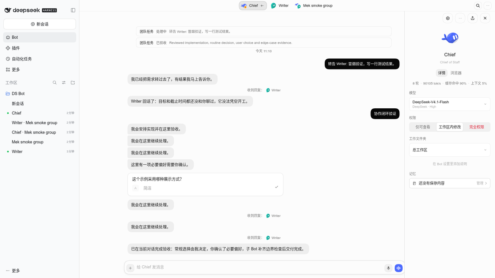

# Bot 面板使用指南

先按[项目首页](../README.md)安装并打开 Bot 面板，再使用这里的导航、会话和权限说明。

## 导航与详情

顶部默认显示主 Bot 和收藏会话。通过 Bot 列表浏览其他成员和群聊，点五角星固定到顶部。未收藏的会话在打开时临时显示，切走后收起，未读消息和任务仍会提示。

再次点击当前会话的顶部标签可展开或关闭详情。清单图标打开“任务”，相邻的“待办”提供当前会话的计划入口。切换 Bot 或群聊时，所选标签随会话更新内容。右上角菜单提供新建、用量、连接器和 Bot 设置。

## 创建群聊

在「Bot 设置 → 群聊 → 新建群聊」里先选管理员，再添加至少一位其他 Bot。群名留空时按成员命名。

单聊和群聊输入框都可用 `@` 搜索候选成员，方向键选择，Enter 或 Tab 插入，Escape 关闭。正式派工在团队任务中独立记录。[任务与团队协作](team-workflows.md)

## 窄屏

顶部的“···”收纳 Bot 列表、任务列表和 Bot 搜索，也会汇总收起会话的未读提示。

## 聊天与状态

- 在输入区选择、粘贴或拖拽图片即可预览，也可以只发图片。发送被拒绝时会保留文字和图片。
- 排队消息显示在输入框旁，点数量可介入当前轮次或移除消息。授权、凭据和其他交互请求显示为独立卡片。
- 模型、密钥和权限沿用 DSH 配置。为新 Bot 选择模型后即可开始聊天，调用使用该服务商的额度。

截图来自 dsh-mek-bot 0.2.4 和隔离 DSH，展示早期界面。

## 相关指南

- [任务派工、待办与验收](team-workflows.md)
- [配置、权限与数据](configuration.md)
- [微信接入](wechatpad.md)
